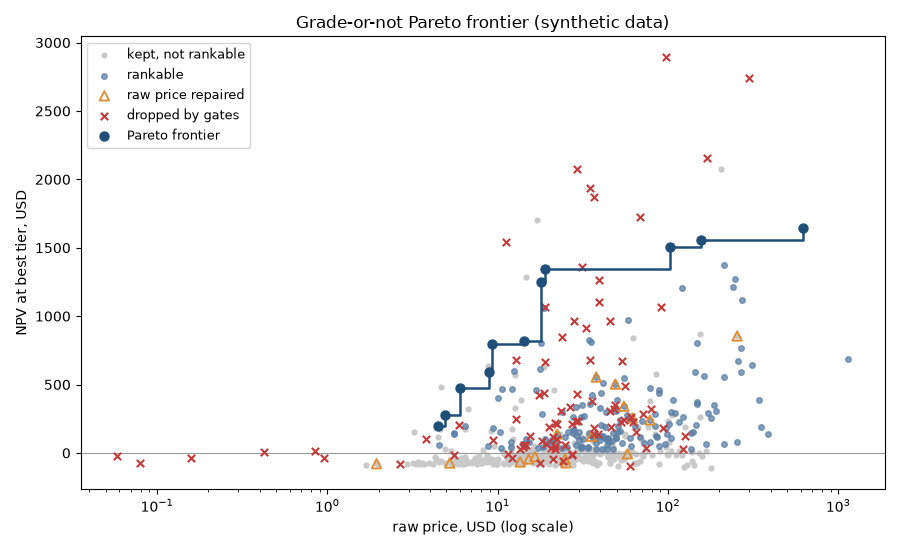
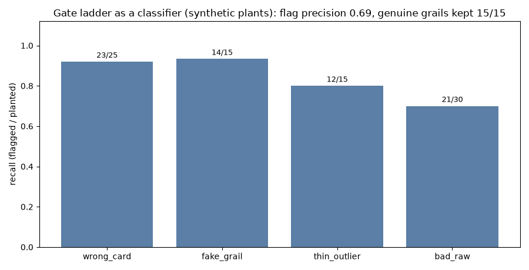
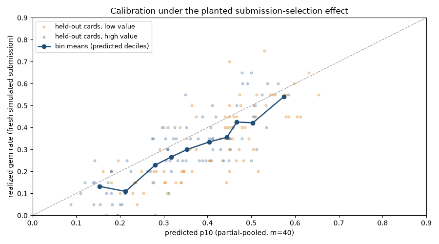
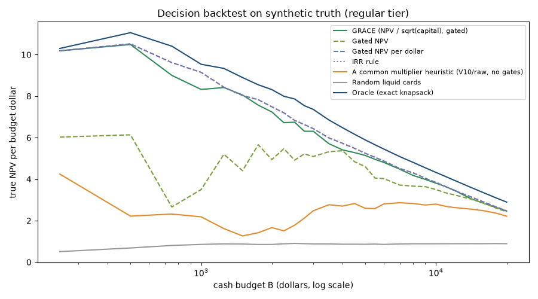

# grace-grading-roi

Should you grade this card? NPV-per-dollar ranking with partial-pooled gem rates, data-quality gates, and a Pareto frontier — with the gates tested as a classifier, the gem rates cross-validated by log loss, and the ranking backtested against an exact-knapsack oracle.

<!-- grace.report:begin headline -->
**Oracle value captured at a $3,000 budget (regular tier, synthetic truth): GRACE 0.857, against 0.336 for a common multiplier heuristic (V10/raw, no gates) and 0.120 for random liquid cards.** 1.000 is the best batch an exact-knapsack oracle can buy knowing the true rates and prices ([reports/numbers.json:1323](reports/numbers.json)).
<!-- grace.report:end headline -->

[](https://github.com/chasebak/grace-grading-roi/actions/workflows/ci.yml)




```bash
git clone https://github.com/chasebak/grace-grading-roi && cd grace-grading-roi
python3 -m venv .venv && source .venv/bin/activate
pip install -e . -r requirements-ci.txt
python -m pytest -q
python -m grace.demo
python -m grace.report --check   # every README number equals a fresh run
python -m grace.viz build --check   # the page's data equal a fresh backtest run
```

**Try it:** *Hand GRACE a Budget* in [`docs/`](docs/index.html). Drag a cash
budget and watch GRACE, the heuristic, random liquid cards and the oracle
refill their batches, with planted-error cards in red. Serve it locally with
`python -m http.server -d docs` and open the printed address; the page is
not hosted yet.

Supported platforms: macOS arm64 and Linux. The demo reads the committed
synthetic data in `synth/`, writes a frontier plot and a top-N table to the
untracked `out/`, and prints its own elapsed time (about a second).

Provenance: Public re-implementation of the grading-ROI engine from my private platform.

## KPIs

Every value below is printed by `python -m grace.report` into
`reports/numbers.json` (the file:line is cited) and copied here by the same
command; `tests/test_readme_drift.py` fails if this README drifts from it.
Reasons for each choice are in [DECISIONS.md](DECISIONS.md); the knobs and
where they come from are in the [assumptions table](MODEL.md#7-assumptions).

<!-- grace.report:begin kpi_table -->
| KPI | formula | why it matters | compared against | what the software does to it | measured on | value now |
|---|---|---|---|---|---|---|
| **Oracle value captured** (headline; $3,000 budget, regular tier) | True-expected NPV of the rule's batch / that of the best feasible batch | How much of the knowable money the ranking finds | A common multiplier heuristic (V10/raw, no gates); random liquid cards; oracle = exact knapsack | GRACE should sit far above the heuristic and below 1.0 | synthetic truth | GRACE 0.857, heuristic 0.336, random 0.120 (reports/numbers.json:1323) |
| Regret and NPV per budget dollar | oracle $ - rule $; rule $ / budget B (not / dollars spent) | Dividing by B means underspending is never rewarded | The heuristic and random; gated NPV per dollar (a = 1); every rule is in the Experiment 4 table | Lower regret than the heuristic and random | synthetic truth | regret GRACE $3,163, heuristic $14,657, random $19,441, gated NPV per dollar $2,779; $ per budget $ GRACE 6.31, heuristic 2.47, random 0.88, gated NPV per dollar 6.43, oracle 7.36; gated NPV per dollar (a = 1) beats GRACE (a = 0.5) here and the IRR rule ties it; a stays 0.5 per DECISIONS.md (reports/numbers.json:1351) |
| Pick optimism | Mean predicted p10 - mean true p10 of the picks; predicted batch $ - true batch $ (shown as a share of true) | Prices the pop-bias caveat on the cards you actually buy | Heuristic picks | Reported, never tuned away | synthetic truth | p10 GRACE +0.043 vs heuristic +0.056; batch $ GRACE +3.8% vs heuristic +77.6% (reports/numbers.json:1330) |
| Corruption leakage | Planted-error cards in the batch / batch size, and their share of capital | Gate recall turned into its business result | Heuristic; the liquid universe's planted base rate | Below the base rate | synthetic truth | GRACE 1/20 picks, 4.0% of capital; heuristic 21/28, 78.5% of capital; liquid base rate 67/451 (reports/numbers.json:1344) |
| Gem-rate log loss gain vs m = 40 | Paired per-fold difference in binomial log loss, estimator - m = 40 (negative = better; plus Brier and ECE), 5-fold CV over cards | A proper scoring rule grades the probabilities themselves | Fixed prior, era mean, raw rate, empirical Bayes and its two cross arms | Shows whether pooling beats no pooling | out-of-sample on the model's own generator | next pop: empirical Bayes -0.0023 ± 0.0011 (5/5), better than m = 40, as are m = 40 toward the era mean and moment m toward the fixed prior; unscreened: empirical Bayes +0.0067 ± 0.0013 (0/5), worse than m = 40, and no estimator beats m = 40 there (fixed prior, the lowest mean log loss, is a null) (reports/numbers.json:1278) |

> **Why this metric.** Of the money a perfectly informed buyer could make with this budget, how much does the ranking find?
> *Kind:* Simulated: closed-form expected NPV at the generator's planted gem rates and true prices (synthetic truth), divided by the exact-knapsack oracle's batch.
> *Could lie if:* It would lie if the oracle were not the best batch (guard: the oracle-bound tests in tests/test_backtest.py); it scores the generator against itself, so the rule order is the claim, not the dollars.

**Guarantees (tests).**

- The oracle is an exact integer-dollar knapsack bracketed between a feasible batch and an upper bound, and no rule's true NPV ever exceeds the upper bound (`tests/test_backtest.py`).
- No rule overspends its budget, and every per-dollar figure divides by the budget (`tests/test_backtest.py`).
- `generate()` reproduces `synth/*.csv` byte for byte, and capturing true prices adds no random draws (`tests/test_golden_data.py`).
- Every number in this README's generated blocks equals `reports/numbers.json`, which equals a fresh run (`tests/test_readme_drift.py`, `tests/test_report.py`).
<!-- grace.report:end kpi_table -->

**Domain primer.** PSA grades trading cards on a 1-10 scale; a 10 ("gem mint")
often sells for a large multiple of a 9 or of the raw (ungraded) card. A pop
(population) report counts how many copies have been graded at each level —
the "pop ladder" — and this engine turns ladders into gem-rate estimates.

*(GRACE here is a grading capital-efficiency score — not the GRACE of
ML explainability, and not the cardiology GRACE risk score.)*

## What it computes

The headline is an **NPV/capital-efficiency ranking with an optional
mean-risk penalty**. For one card at one grading service tier:

```
Q   = p10*(V10*(1-f) - s) + p9*(V9*(1-f) - s) + p_le8*(Vle8*(1-f) - s)   expected net sale
R   = qty*(raw_cost + grading_fee) + other_fixed                          capital committed
T   = grading_months + sale_months
U   = 1 / (1 + r)^(T/12)                                                  discount factor
NPV = Q*qty*U - R
```

*(f = selling fee, s = ship/pack, r = annual discount rate, V10/V9/Vle8 =
expected sale price by grade.)*

Defaults (all configuration in `grace/config.py`): sale time 1.5 months,
annual discount rate 0.12, sell fee 13%, ship/pack $5. Tiers come from
PSA's [public published fee schedule](https://www.psacard.com/pricing)
(e.g. Regular $79.99 / ~1.2 mo, Express $149 / ~0.7 mo, Super Express
$299 / ~0.35 mo, Walk-Through $599 / ~0.25 mo). Tier choice is argmax NPV —
a small decision tree under uncertainty. Annualized ROI
`((Q*qty*U)/R)^(12/T) - 1` is computed but display-capped: a hover-style
metric, never the ranking. Marginal NPV versus selling raw today is
`npv + (raw - max(raw*(1-f) - s, 0))`.

**Grade legs.** V9 falls back to `0.5*V10` when unobserved (labeled
synthetic); V&le;8 defaults to the raw price — a sub-9 resells at roughly raw
while you still paid the grading fee.

**Gem rates: partial pooling.** Observed pop ladders shrink toward an era
base rate with a fixed pseudo-count `m = 40` (this is partial pooling with a
fixed pseudo-count, not "empirical Bayes" — m is not estimated from the data):

```
p10    = (n10 + m*mu_era) / (n_ladder + m)
share9 = (n9 + m/2) / (n9 + n_le8 + m)      splits the remaining mass
```

A card with no pop at all gets `p10 = mu_era`, rest 50/50, flagged `prior`.
The era defaults are illustrative era base rates, sensitivity-analyzed
(modern 0.45 / mid 0.30 / vintage 0.18). Public gem-rate statistics (e.g.
GemRate's published reports; PSA's public population pages) show era-level
differences of this order.

**The GRACE score.** `GRACE = (NPV - lambda*sigma) / R^a`, defaults
`lambda = 0`, `a = 0.5`: the default ranking is capital-efficiency
NPV/&radic;capital; lambda is an optional mean-risk penalty (in the sense of
Ogryczak & Ruszczyński [1]). `sigma` is the probability-weighted stdev
of per-grade net payoffs, computed on **discounted** payoffs so sigma and NPV
share one scale.

**Pop-bias caveat.** pop-derived gem rates are conditional on the submission
decision: submitters pre-screen condition, crack-and-resubmit 9s, and cross
over from other graders, so observed gem rates are an optimistic estimate of
P(10) for an unscreened raw card; the engine treats them as an upper bound,
partially offset by the raw-price gates.

## The gate ladder

Market feeds mismatch cards and carry junk prices, so plausibility gates run
before any scoring (`grace/gates.py`, in ladder order):

| # | Rule | Action |
|---|------|--------|
| 1 | V10 > 3.0&times; the third-party graded-10 sold median (median needs n&ge;3) | DROP `wrong_card_match` |
| 2 | V10/V9 > 60 (above the genuine ceiling, measured on production (private data)) | DROP `ratio_above_ceiling` |
| 3 | No V9, &le;1 lifetime feed sale, V10 > $200 | DROP `thin_outlier` |
| 4 | V10 &ge; $1,000 with zero graded-sold corroboration and &le;2 feed sales | DROP `unsupported_high_value` |
| 5 | Ungraded sold median (n&ge;3, discarded if &ge; V10) is primary truth: raw < median/3 repairs raw to the median (`raw_confidence=repaired`). No signal: structural floors — raw < 0.02&middot;V9 (or < 0.005&middot;V10 when no V9) repairs from a plausible near-mint price if available, else DROP | REPAIR / DROP `raw_below_floor_no_signal` |
| 6 | Post-repair raw < $1 | DROP `raw_below_one_dollar` |
| 7 | Effective multiplier > 100&times; with NO graded-sold corroboration (corroborated grails (genuinely very-high-multiplier cards) exempt) | DROP `uncorroborated_multiplier` |

After scoring, **rankability gates** hide rather than drop (the way a UI
filter would): NPV &ge; $25, liquidity &ge; 3 graded-10 sales within the
last 180 days (the 180-day window is a property of the input column
`grade10_sales_180d`, not an engine knob), and era-dependent raw floors
($1 modern / $2 mid / $2 vintage). The **Pareto frontier** is the
non-dominated staircase over (raw price, NPV) among gated cards: the cards
where no card as cheap or cheaper has a higher NPV.

Production scale, for context — production (private data): an adversarial
audit found raw-price errors up to 69,100&times;; plausibility gates cut the
scored universe 5,810 &rarr; 3,835.

## Experiment 1 — the gates as a classifier

"How do you know the gates didn't kill real grails?" The synthetic generator
(`grace/synth.py`, seeded) plants pathologies at known rows — wrong-card
matches, fake grails, thin outliers, corrupted raws — plus **genuine grails**
(80-300&times; multipliers WITH graded-sold corroboration) that the ladder
must keep. Plants deliberately straddle the gate thresholds (e.g. wrong-card
inflation drawn 2.2-9&times; against the 3&times; gate; ~20% of corrupted
raws divided by only 1.5-2.8&times;, too mild for the repair rules to see),
so recall measures sensitivity to borderline corruption rather than
rewarding easy cases. The generator also plants a **borderline-legit clean
subpopulation** (68 of the 500 clean cards) that precision is measured
against: hot-market cards whose graded-10 sold median lags the feed V10,
sparse-history new releases with no graded-sold record yet, honest V10/V9
ratios drawn into the 40-75 tail against the 60 ceiling, and corroborated
80-120&times; grails that exercise the multiplier exemption from the legit
side. Without cards like these, precision is 1.00 by construction — clean
cards that never approach a gate cannot be false-flagged, and the number
means nothing. `python -m grace.experiments.gates_eval` prints:

<!-- grace.report:begin exp1_output -->
```
pathology      planted caught  recall
wrong_card          25     23    0.92
fake_grail          15     14    0.93
thin_outlier        15     12    0.80
bad_raw             30     21    0.70
flag precision (flagged cards that were planted): 0.69
drop precision (dropped cards that were planted): 0.64
clean cards flagged: 31/500
genuine grails kept: 15/15
borderline exempt grails kept: 16/16
false-positive cost: 31 clean cards dropped, 24 with positive shadow NPV, $9,584 NPV forgone
```
<!-- grace.report:end exp1_output -->



<!-- grace.report:begin exp1_why -->
> **Why this metric.** Do the gates catch junk feed rows without killing real grails?
> *Kind:* Counted: gate decisions against the generator's planted labels (synthetic truth), as recall per pathology and flag precision.
> *Could lie if:* Plants that never approach a threshold would make recall and precision 1.00 by construction; plants straddle the gates on both sides (guard: tests/test_experiments.py, tests/test_gates.py).
<!-- grace.report:end exp1_why -->

Every recall miss is a sub-threshold plant (wrong-card matches inflated
only 2.21&times; and 2.82&times; against the 3&times; gate; thin outliers
at $171-$197 against the $200 gate; a $931 fake-grail plant against the
$1,000 gate; corrupted raws divided by only 1.6-2.6&times;). Precision is
a real trade, not a free lunch: the ladder flags 31 of the 500 clean cards
— per the script's drop-reason breakdown, 12 hot-market cards whose
lagging sold median makes them look like wrong-card matches, 14 sparse new
releases the thin-outlier gate cannot tell from junk, and 5 honest
ratio-tail cards above the 60&times; ceiling. Those false positives cost a
buyer real money: 24 of the 31 carried positive shadow NPV, $9,584 of it
forgone on this draw — the price paid for 0.70-0.93 recall on planted
corruption at 0.69 flag precision. The corroboration exemption earns its
keep on both sides: all 15 genuine grails and all 16 borderline
80-120&times; grails survive.

## Experiment 2 — is the fixed m=40 reasonable?

`python -m grace.experiments.m_estimation` estimates the pooling pseudo-count
from the synthetic ladders' overdispersion with a beta-binomial
method-of-moments estimator, checks calibration on held-out cards, and
stress-tests the illustrative priors:

<!-- grace.report:begin exp2_output -->
```
beta-binomial method-of-moments pseudo-count (vs fixed m=40):
  mid      m_hat = 26.6
  modern   m_hat = 28.8
  vintage  m_hat = 17.4
held-out cards: 165
mean (predicted - realized) gem rate: +0.059
  low-value cards:  +0.076
  high-value cards: +0.042
prior sensitivity (Spearman of GRACE ranking vs default priors):
  era priors -0.10: rho = 0.995
  era priors +0.10: rho = 0.994
```
<!-- grace.report:end exp2_output -->

The fixed `m = 40` shrinks somewhat harder than the method-of-moments
estimates (17-29 on this data) — conservative toward the era mean. The
calibration plot shows predictions sitting above realized gem rates
(realized = a fresh simulated submission at each card's latent true rate),
most strongly for low-value cards: that is the planted submission-selection
effect, and it is exactly the optimism the pop-bias caveat above warns
about. Shifting every era prior by &plusmn;0.10 barely reorders the ranking
(Spearman &rho; &ge; 0.994), which is what "illustrative, sensitivity-analyzed"
means here.



<!-- grace.report:begin exp2_why -->
> **Why this metric.** Are the pooled gem rates honest for a card nobody pre-screened?
> *Kind:* Simulated: pooled p10 against a fresh simulated submission at each held-out card's latent rate (out-of-sample on the model's own generator).
> *Could lie if:* One 30% holdout with one seed can be lucky; the planted selection effect must show as predictions above realized (guard: test_calibration_shows_planted_optimism).
<!-- grace.report:end exp2_why -->

## Experiment 3 — are the gem-rate probabilities any good?

Experiments 1 and 2 test the cleaning, the size of m and one holdout's
calibration; neither grades the probabilities with a proper scoring rule,
and those probabilities feed every dollar figure.
`python -m grace.experiments.gem_cv` cross-validates seven gem-rate
estimators over cards (every card's ladder and outcome sit in exactly one
test fold), and scores each on a fresh simulated submission per card with
proper scoring rules: binomial log loss, the Brier score and the expected
calibration error (ECE). The estimators: the fixed era prior; the era mean
of the training folds; the raw rate n10 / n (the era mean for an empty
ladder); the shipped pooling at m = 40; empirical Bayes, with m fit by
beta-binomial moments on the training folds only; and two cross arms that
change one half of empirical Bayes each (m = 40 toward the era mean, and
the moment m toward the fixed prior), so a gap can be traced to the shrink
target or to the shrink strength. Two targets: the **next
pop submissions** (drawn at each card's observed, selection-boosted rate,
the rate its ladder came from) and **unscreened raw cards** (drawn at its
latent rate, which every ladder overstates). A reference row predicts the
true rate itself; no estimator can know it, so it marks the floor.

<!-- grace.report:begin exp3_tables -->
600 cards (46 with empty ladders), 5 folds over cards (120/120/120/120/120 test cards); outcome = one fresh 20-card submission per card; log loss clipped to [1e-06, 1 - 1e-06]; ECE over 10 equal-width bins. Each score is mean ± sd over the folds; "vs m = 40" is the paired per-fold difference (estimator - m = 40, negative = better) with the folds in which the estimator beat m = 40; a gap under one fold sd is a null.

Target: next pop submissions (observed, selection-boosted rate).

| estimator | log loss | vs m = 40 | verdict | Brier | ECE | clipped |
|---|---:|---:|---|---:|---:|---:|
| Fixed era prior | 0.6355 ± 0.0094 | +0.0157 ± 0.0034 (0/5 folds better) | worse | 0.2228 ± 0.0046 | 0.0518 ± 0.0075 | 0 |
| Era mean (training folds) | 0.6307 ± 0.0074 | +0.0108 ± 0.0012 (0/5 folds better) | worse | 0.2205 ± 0.0036 | 0.0238 ± 0.0075 | 0 |
| Raw rate n10 / n | 0.6436 ± 0.0214 | +0.0238 ± 0.0241 (0/5 folds better) | null | 0.2172 ± 0.0025 | 0.0271 ± 0.0059 | 7 |
| Shipped pooling, m = 40 | 0.6199 ± 0.0067 | (baseline) | - | 0.2159 ± 0.0032 | 0.0333 ± 0.0084 | 0 |
| Cross arm: m = 40 toward the era mean | 0.6183 ± 0.0058 | -0.0015 ± 0.0010 (5/5 folds better) | better | 0.2151 ± 0.0028 | 0.0277 ± 0.0050 | 0 |
| Cross arm: m fit by moments, toward the fixed prior | 0.6188 ± 0.0068 | -0.0010 ± 0.0006 (5/5 folds better) | better | 0.2155 ± 0.0032 | 0.0309 ± 0.0083 | 0 |
| Empirical Bayes, m fit by moments | 0.6175 ± 0.0060 | -0.0023 ± 0.0011 (5/5 folds better) | better | 0.2148 ± 0.0028 | 0.0237 ± 0.0061 | 0 |
| True rate (reference, unknowable) | 0.6107 ± 0.0043 | -0.0092 ± 0.0034 (5/5 folds better) | reference | 0.2119 ± 0.0020 | 0.0217 ± 0.0049 | 0 |

Target: unscreened raw cards (latent rate).

| estimator | log loss | vs m = 40 | verdict | Brier | ECE | clipped |
|---|---:|---:|---|---:|---:|---:|
| Fixed era prior | 0.5885 ± 0.0093 | -0.0001 ± 0.0029 (2/5 folds better) | null | 0.2011 ± 0.0043 | 0.0409 ± 0.0120 | 0 |
| Era mean (training folds) | 0.5989 ± 0.0079 | +0.0103 ± 0.0046 (0/5 folds better) | worse | 0.2059 ± 0.0036 | 0.0783 ± 0.0147 | 0 |
| Raw rate n10 / n | 0.6388 ± 0.0223 | +0.0502 ± 0.0271 (0/5 folds better) | worse | 0.2106 ± 0.0047 | 0.0922 ± 0.0121 | 7 |
| Shipped pooling, m = 40 | 0.5886 ± 0.0084 | (baseline) | - | 0.2016 ± 0.0039 | 0.0637 ± 0.0079 | 0 |
| Cross arm: m = 40 toward the era mean | 0.5946 ± 0.0076 | +0.0060 ± 0.0016 (0/5 folds better) | worse | 0.2043 ± 0.0035 | 0.0821 ± 0.0105 | 0 |
| Cross arm: m fit by moments, toward the fixed prior | 0.5902 ± 0.0081 | +0.0016 ± 0.0009 (0/5 folds better) | worse | 0.2023 ± 0.0038 | 0.0676 ± 0.0076 | 0 |
| Empirical Bayes, m fit by moments | 0.5953 ± 0.0075 | +0.0067 ± 0.0013 (0/5 folds better) | worse | 0.2047 ± 0.0034 | 0.0830 ± 0.0097 | 0 |
| True rate (reference, unknowable) | 0.5706 ± 0.0123 | -0.0180 ± 0.0043 (5/5 folds better) | reference | 0.1941 ± 0.0052 | 0.0126 ± 0.0031 | 0 |
<!-- grace.report:end exp3_tables -->

<!-- grace.report:begin exp3_why -->
> **Why this metric.** Are the gem-rate probabilities themselves any good, and does pooling beat no pooling?
> *Kind:* Simulated: 5-fold cross-validation over cards, scored by log loss, Brier and ECE against a fresh simulated submission per card (out-of-sample on the model's own generator), paired fold by fold against the shipped m = 40.
> *Could lie if:* Era means or m_hat fit on all cards would leak the test fold (guard: test_changing_the_test_fold_leaves_the_fit_unchanged); a gap under one fold sd is printed as a null, and the log-loss clip count is shown so a 0-or-1 prediction cannot hide.
<!-- grace.report:end exp3_why -->

What the cross-validation found:

<!-- grace.report:begin exp3_findings -->
- **Fold fits:** training-fold m_hat runs mid 25.6-29.7, modern 24.8-32.0, vintage 15.8-19.0, so the fixed m = 40 shrinks harder than every fold's fit. The fixed era priors (mid 0.30, modern 0.45, vintage 0.18) sit below every fold's era mean (mid 0.321-0.332, modern 0.498-0.509, vintage 0.195-0.210) in 3 of 3 eras.
- **Next pop:** the best real estimator by log loss is empirical Bayes (0.6175 ± 0.0060). Against m = 40 (folds better): fixed prior worse (0/5), era mean worse (0/5), raw rate null (0/5), m = 40 toward the era mean better (5/5), moment m toward the fixed prior better (5/5), empirical Bayes better (5/5). The unknowable true rate sits 0.0092 below m = 40, the room any estimator has left.
- **Unscreened:** the best real estimator by log loss is fixed prior (0.5885 ± 0.0093). Against m = 40 (folds better): fixed prior null (2/5), era mean worse (0/5), raw rate worse (0/5), m = 40 toward the era mean worse (0/5), moment m toward the fixed prior worse (0/5), empirical Bayes worse (0/5). The unknowable true rate sits 0.0180 below m = 40, the room any estimator has left.
- **Clipping:** the log-loss clip moved raw rate predictions (7 on next pop, 7 on unscreened): ladders with no gems or all gems give a prediction of exactly 0 or 1. It moved none for fixed prior, era mean, m = 40, m = 40 toward the era mean, moment m toward the fixed prior, empirical Bayes.
- **m stays 40:** empirical Bayes against m = 40 is better on next pop and worse on unscreened. It changes two things at once, the shrink target (fixed prior to era mean) and the shrink strength (40 to m_hat); the cross arms split them: on next pop, the target alone -0.0015 ± 0.0010 (5/5), better, the strength alone -0.0010 ± 0.0006 (5/5), better; on unscreened, the target alone +0.0060 ± 0.0016 (0/5), worse, the strength alone +0.0016 ± 0.0009 (0/5), worse. m stays 40 (DECISIONS.md); any switch gets its own commit.
<!-- grace.report:end exp3_findings -->

Why the two targets can disagree: the ladders were drawn at the boosted
rate, so an estimator that fits the ladders closely is rewarded on the next
pop submissions, while an unscreened raw card (what a grader actually
holds) gems at its lower latent rate, so shrinking harder, or toward a lower
centre, is rewarded there. The scores are per-trial log loss on the
generator's own draws: read them as order, not as money.

## Experiment 4 — does the ranking find the money?

The gates and the gem rates were each tested on their own; this is the
test of the whole pipeline on the business question. Every ranking rule
gets the same cash budget and buys down its own ranked list until the
budget is spent (a greedy fill, charged at the price actually paid). Each
batch is then scored on **synthetic truth**: the closed-form expected NPV at
every card's planted gem rate and true prices, graded at the regular tier
with the engine's own fees and discounting. The true prices of junk-feed
rows are those of the base card the junk replaced; they are captured in
memory by `synth.generate_world()`, so the committed CSVs do not change.

The rules: GRACE; gated NPV; gated NPV per dollar; an IRR rule; a common
multiplier heuristic (V10/raw from the feed, no gates); random liquid cards
(the mean over seeded shuffles); and the **oracle**, the best batch you could
buy knowing the true rates and prices. The oracle is an exact integer-dollar
0/1 knapsack, solved twice: rounding each card's capital up gives a batch
that is feasible at the real prices, rounding it down gives an upper bound
that no feasible batch can beat. The universe is the liquid cards only, the
same for every rule. `python -m grace.experiments.backtest` prints the
$1,000 / $3,000 / $10,000 tables and draws the sweep; `python -m
grace.report` writes them, with the budget sweep the page's slider uses, to
`reports/`, and redraws the sweep chart below from those sweep cells
(`--check` fails if the chart's stored series digest is stale):

<!-- grace.report:begin exp4_tables -->
Oracle value captured (true NPV of the batch / the oracle's):

| rule | $1,000 | $3,000 | $10,000 |
|---|---:|---:|---:|
| GRACE (NPV / sqrt(capital), gated) | 0.873 | 0.857 | 0.880 |
| Gated NPV | 0.367 | 0.691 | 0.809 |
| Gated NPV per dollar | 0.959 | 0.874 | 0.888 |
| IRR rule | 0.959 | 0.874 | 0.888 |
| A common multiplier heuristic (V10/raw, no gates) | 0.229 | 0.336 | 0.647 |
| Random liquid cards | 0.090 | 0.120 | 0.205 |
| Oracle (exact knapsack) | 1.000 | 1.000 | 1.000 |

> **Why this metric.** Of the money a perfectly informed buyer could make with this budget, how much does the ranking find?
> *Kind:* Simulated: closed-form expected NPV at the generator's planted gem rates and true prices (synthetic truth), divided by the exact-knapsack oracle's batch.
> *Could lie if:* It would lie if the oracle were not the best batch (guard: the oracle-bound tests in tests/test_backtest.py); it scores the generator against itself, so the rule order is the claim, not the dollars.

Every rule at the $3,000 budget:

| rule | regret | true NPV per budget $ | planted picks | planted capital share | pick optimism (p10) | pick optimism ($) |
|---|---:|---:|---:|---:|---:|---:|
| GRACE (NPV / sqrt(capital), gated) | $3,163 | 6.31 | 1/20 | 4.0% | +0.043 | $723 (+3.8%) |
| Gated NPV | $6,817 | 5.09 | 0/12 | 0.0% | +0.025 | $72 (+0.5%) |
| Gated NPV per dollar | $2,779 | 6.43 | 1/24 | 4.0% | +0.048 | $715 (+3.7%) |
| IRR rule | $2,779 | 6.43 | 1/24 | 4.0% | +0.048 | $715 (+3.7%) |
| A common multiplier heuristic (V10/raw, no gates) | $14,657 | 2.47 | 21/28 | 78.5% | +0.056 | $5,761 (+77.6%) |
| Random liquid cards | $19,441 | 0.88 | 3.4/22.7 (mean) | 13.8% | +0.062 | $988 (+117.1%) |
| Oracle (exact knapsack) | $0 | 7.36 | 1/22 | 3.9% | +0.035 | $549 (+2.5%) |

> **Why this metric.** How many dollars does each rule leave on the table at this budget?
> *Kind:* Simulated: oracle true NPV minus the rule's true NPV, and the rule's true NPV divided by the budget B (synthetic truth).
> *Could lie if:* Dividing by dollars spent would reward a rule that leaves cash idle, and an overspent budget would inflate it (guards: test_denominator_is_the_budget, test_no_rule_overspends_the_budget).

> **Why this metric.** On the cards a rule actually buys, how much rosier is the engine than the truth?
> *Kind:* Simulated: mean predicted p10 minus mean planted p10 of the picks, and predicted batch NPV minus true batch NPV (synthetic truth).
> *Could lie if:* It would hide the pop-bias caveat if the truth reused the selection-boosted or predicted rates; every universe row's true NPV is recomputed from the planted latent rate and true prices, and a control shows the predicted rate gives other values (guard: test_universe_true_npv_is_recomputed_from_the_truth). It is reported, never tuned away.

> **Why this metric.** How much of the budget goes to cards whose feed prices are junk?
> *Kind:* Counted: planted-error cards in the batch over batch size, and their share of the capital spent, against the liquid universe's planted base rate.
> *Could lie if:* It would flatter the gates if junk cards were scored at their junk prices; they are scored at the base card's true prices (guard: test_junk_plants_true_prices_are_the_base_card).

Oracle bracket (feasible batch vs knapsack upper bound): $1,000: feasible $9,533, upper bound $9,569 (width 0.37%); $3,000: exact at $22,081; $10,000: feasible $43,222, upper bound $43,367 (width 0.34%).
<!-- grace.report:end exp4_tables -->



<!-- grace.report:begin exp4_sweep_why -->
> **Why this metric.** Does the rule order hold at every budget, or only at the one quoted?
> *Kind:* Simulated: true NPV per budget dollar at each solved budget of the sweep, each budget filled on its own (greedy fills are not nested).
> *Could lie if:* A sweep cell that differed from the standalone run would mean two different backtests (guard: test_sweep_cell_equals_standalone_run).
<!-- grace.report:end exp4_sweep_why -->

What the backtest found (every count is over the sweep's solved budgets):

<!-- grace.report:begin exp4_findings -->
- **Universe:** 451 liquid cards, 67 of them planted errors (base rate 0.149); 169 pass the gates, 13 of those planted.
- **Order holds across the sweep:** GRACE beats the heuristic at 28 of 28 budgets ($250-$20,000), the heuristic beats random at 28 of 28, and GRACE's leakage sits below the base rate at 28 of 28.
- **a = 1 beats the shipped a = 0.5 under a cash budget:** gated NPV per dollar captures 0.874 against GRACE's 0.857 at $3,000, and has more true NPV at 24 of 28 budgets. a stays 0.5 (DECISIONS.md); any switch gets its own commit.
- **The IRR rule picks the same batch as gated NPV per dollar** at 28 of 28 budgets: at one tier the cash cycle T is the same for every card, so annualized ROI is a monotone function of NPV / capital.
- **A greedy oracle is not an upper bound:** filling by absolute true NPV, some rule beats it by up to $4,097 on the sweep, which is why the oracle is an exact knapsack.
<!-- grace.report:end exp4_findings -->

Read the rule order and the oracle value captured first: the truth is the
generator's own, so regret and the other dollar figures are in the
generator's dollars, while which rule finds more of the knowable money is
the claim.

## Demo output

`python -m grace.demo` on the committed synthetic set:

<!-- grace.report:begin demo_output -->
```
cards scored:    600
kept:            515
dropped:         85
repaired raws:   16
rankable:        169
on frontier:     11
```
<!-- grace.report:end demo_output -->

## Design decisions / what didn't work

- **A flat multiplier cap didn't work.** An earlier production rule capped
  V10/raw at a flat 150&times;; on production (private data) it dropped ~265
  genuine high-multiplier cards and missed bad-raw cards. The current ladder
  replaces it with corroboration-aware rules: repair the raw when a sold
  median contradicts it, and only cap multipliers that nothing corroborates.
- **One discount scale.** The production engine computed sigma on
  undiscounted payoffs next to a discounted NPV; the public version computes
  both on discounted payoffs so they share one scale.
- **Risk penalty off by default.** Production ran risk-penalized variants;
  the public default is the plain capital-efficiency ranking (`lambda = 0`).
- **Drops before repairs.** Identity failures (wrong-card, thin, unsupported)
  drop before the repair step so a mismatched card is dropped for what it is
  rather than having its raw "repaired" toward an unrelated card's median;
  the post-repair rules (sub-$1 raw, multiplier cap) then run on the
  repaired raw.
- **Plants straddle the thresholds — on both sides.** Planting only
  clear-cut pathologies makes every recall 1.00 and tests nothing; the
  generator draws plants across the gate boundaries so the classifier
  numbers can actually move. An earlier draft of this repo had the same
  problem with precision: with no clean cards anywhere near a gate,
  precision was 1.00 by construction, so the generator now plants a
  borderline-legit clean subpopulation the ladder can actually lose.
- **The cheap slow tier keeps winning.** On this synthetic set argmax-NPV
  picks the cheapest tier for every rankable card: at a 12% annual discount
  rate, saving half a month of turnaround is worth ~0.5% of the discounted
  proceeds, which never
  beats a $69+ fee gap at these card values. Faster tiers only pay for
  far more expensive cards than this generator produces.

## What this does NOT claim

- **Not portfolio optimization.** GRACE is a single-asset mean-risk
  criterion; there are no covariances and no allocation step (hence the
  Ogryczak & Ruszczyński framing rather than Markowitz).
- **Not investment advice.** It is a decision-support ranking on noisy data.
- **The era priors are illustrative** rounded defaults, sensitivity-analyzed
  above; they carry no numeric source attribution.
- **Gem rates are submission-conditioned** (see the pop-bias caveat): the
  engine's P(10) is an upper bound for an unscreened raw card.
- Prices come only from a licensed third-party market-data feed in
  production; this repo ships synthetic data only.
- **The decision backtest is simulated.** Experiment 4 scores the
  generator against itself: the truth is the generator's planted gem rates
  and prices, not real grading outcomes.
- **Experiment 3 scores the estimators on the generator's own world.** The
  pop ladders and the outcomes are draws from the same beta-binomial
  generator, so the cross-validation says which estimator fits this world,
  not which one fits real pop reports; the fold-to-fold spread, not a
  p-value, is the error bar.
- **Absolute backtest dollars are generator artifacts.** The claims are
  the rule order and the oracle value captured (a ratio); regret and every
  other dollar figure are shown in the generator's dollars. Resale noise
  and time to sell are not modelled.
- **The page shows no spread band.** Its lines come from one synthetic
  world, so how much they would move under another generator seed is to
  measure. The page computes nothing; it looks up and formats `docs/data/`,
  which `python -m grace.viz build` writes from the Experiment 4 functions.

More math background (derivations, the method-of-moments estimator, decision-
tree framing) lives in [MODEL.md](MODEL.md).

[1] W. Ogryczak and A. Ruszczyński, "From stochastic dominance to
mean-risk models: Semideviations as risk measures," *European Journal of
Operational Research* 116 (1999) 33-50.

---

Part of a set of public repos extracted from my card-business tooling — see my GitHub profile for the map.
